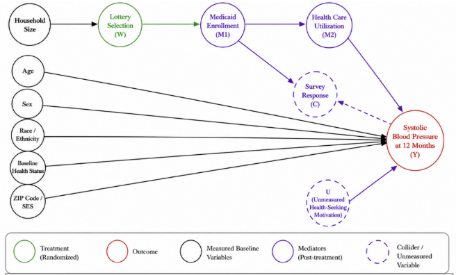

# Causal Effect of Medicaid Expansion on Blood Pressure

Does being offered Medicaid lower blood pressure within a year? Using the Oregon Health Insurance Experiment, where Medicaid eligibility was assigned by lottery, we estimate the intent-to-treat (ITT) effect of lottery selection on systolic blood pressure 12 months later.

* **Course:** BIOSTAT 125, UCLA (Spring 2026)
* **Team:** Yoonseo Yeo, Asher Izower, Kethy Zhang
* **My Role:** Led the analysis for balance diagnostics (Q3), confounding and backdoor paths (Q4), and threats to validity (Q8), and revised the full presentation for consistency across all sections.

📄 **[Final Report (PDF)](./report/BIOSTAT125_Final_Report.pdf)** · 📊 **[Slides (PDF)](./slides/BIOSTAT125_Slides.pdf)**

---

### Question
For low-income uninsured adults in Oregon's 2008 Medicaid lottery, what is the average effect of being selected on systolic blood pressure (SBP) about 12 months later?
* **Treatment ($W$):** Selected in the lottery (an offer of Medicaid, not enrollment)
* **Outcome ($Y$):** SBP in mmHg, measured at in-person screenings
* **Estimand:** ITT effect, $\mathbb{E}[Y(1) - Y(0)]$. We focused on a single pre-chosen outcome to avoid multiple testing across the many outcomes in the dataset.

### Data
* **Source:** Oregon Health Insurance Experiment public-use data, distributed by NBER (free NBER login required). We used a cleaned version prepared by the course instructor, which is not included in this repository.
* **Sample Overview:** About 30,000 names were drawn from a waitlist of roughly 90,000, and only about 30% of those selected actually enrolled.
* **Data Citation:** Finkelstein, A., Baicker, K., Taubman, S., et al. (2018). *Replication Data for: Oregon Health Insurance Experiment*. Harvard Dataverse. https://doi.org/10.7910/DVN/SJG1ED

### Methods
1. **Balance Check:** Standardized mean differences across 23 baseline covariates (Love plot). 22 of 23 were below 0.1. Household size was the exception ($\text{SMD} \approx 0.20$), because the lottery let a whole household enroll from one selected name.
2. **Causal DAG:** Built a DAG for lottery selection, enrollment, SBP, and baseline covariates to identify the adjustment set for the ITT effect.
3. **Estimation:** Compared an unadjusted regression with inverse probability weighting (IPW), using household size in the propensity score model.
4. **Heterogeneity:** Pre-specified baseline hypertension as an effect modifier and estimated conditional average treatment effects (CATE) with an interaction test.
5. **Threats to Validity:** Discussed non-compliance, attrition, and collider bias from conditioning on survey response.

<p align="center">
  
  
</p>

### Results

| Estimator | ITT Estimate | 95% CI | p-value |
| :--- | :---: | :---: | :---: |
| **Unadjusted regression** | 0.05 mmHg | [−0.54, 0.64] | 0.864 |
| **IPW** | 0.05 mmHg | [−0.54, 0.64] | 0.864 |

* Both estimators gave the same null result: lottery selection did not measurably change SBP after 12 months.
* **CATE:** $+0.36\text{ mmHg}$ without baseline hypertension and $-0.39\text{ mmHg}$ with it (interaction $-0.75\text{ mmHg}$, $\text{SE} = 1.08$, $p = 0.49$). The direction matched our hypothesis, but the data could not tell the two groups apart.

<p align="center">
  
</p>

### Takeaways
* A null ITT result here is not evidence that Medicaid has no effect. With only about 30% take-up, any effect of actual coverage is heavily diluted, and 12 months is short for a chronic outcome like blood pressure.
* *"No significant subgroup difference"* is different from *"the subgroups respond the same."* We report the interval rather than treating the null as a finding.

### Limitations
* **Non-compliance:** We estimate the effect of the offer, not of enrollment. An instrumental variable (IV) analysis using the lottery would target the effect among compliers.
* **Attrition:** Missing 12-month follow-ups may not be random.
* **Collider bias:** Analyzing only survey respondents conditions on a variable affected by both enrollment and health.

### Tools
The analysis was carried out in Professor Falco J. Bargagli Stoffi's website, a web-based causal inference tool provided for the course, so this repository contains the report, slides, and figures rather than code.

### Repository Structure
```text
├── README.md
├── report/
│   └── BIOSTAT125_Final_Report.pdf
├── slides/
│   └── BIOSTAT125_Slides.pdf
└── figures/
    ├── love_plot.png
    ├── dag.png
    └── cate_by_hypertension.png
